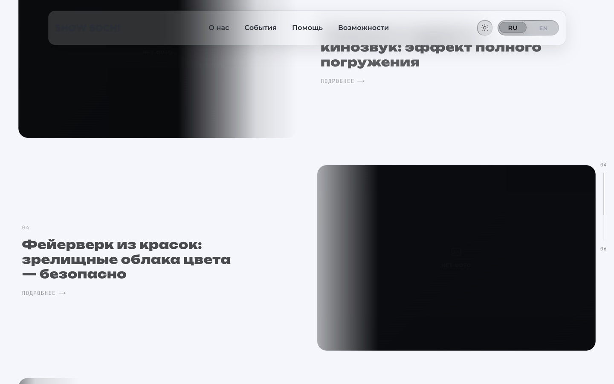
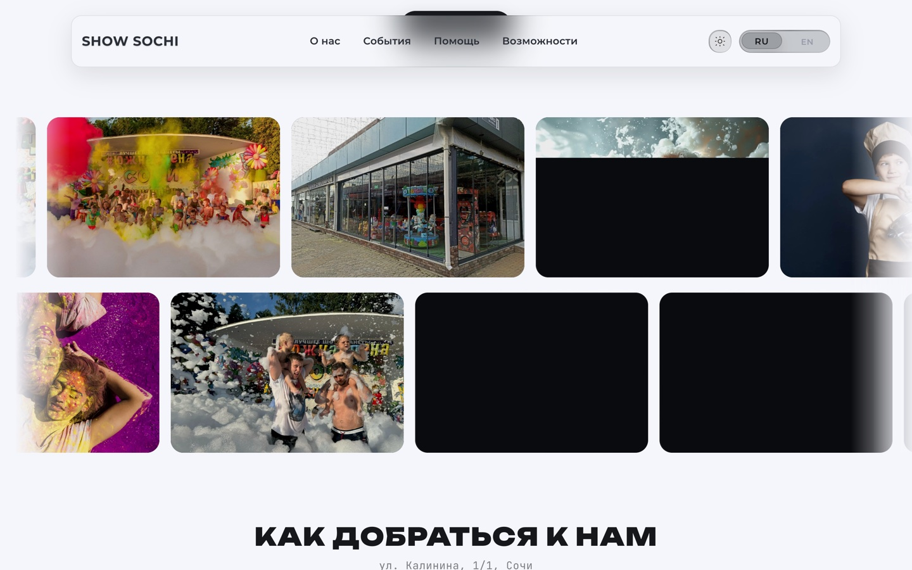
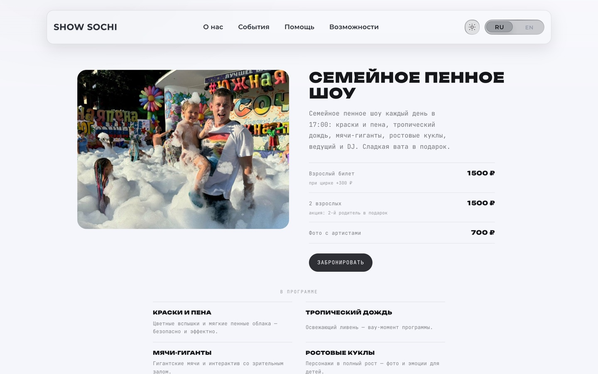
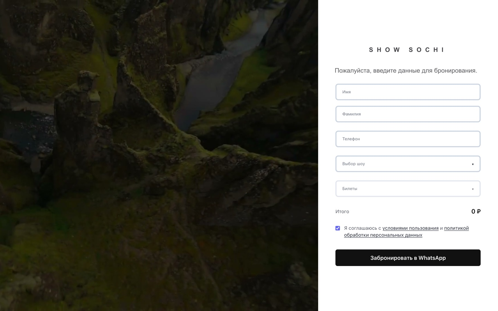
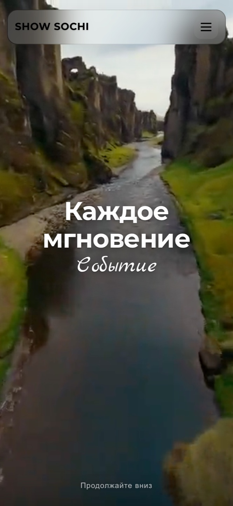

<div align="center">

# ШоуСочи — сайт амфитеатра

**Площадка, где бронирование уходит в WhatsApp, а весь контент правится из админки.**
Видео-первый экран с дроном, лендинги трёх форматов шоу, заявка на билет без
платёжного шлюза и редактор расписания поверх `Setting` — ключ/значение в PostgreSQL.

**Демо:** <https://show-sochi.vercel.app> · **Прод клиента:** `шоусочи.рф` (IP сервера в репозитории не публикуется)


</div>

---

<table>
  <tr>
    <td width="50%"></td>
    <td width="50%"></td>
  </tr>
  <tr>
    <td></td>
    <td></td>
  </tr>
  <tr>
    <td></td>
    <td></td>
  </tr>
  <tr>
    <td colspan="2" align="center"></td>
  </tr>
</table>

## Задача

У площадки с сезонной программой две вечные проблемы: расписание меняется каждую
неделю, а билетная система стоит дороже, чем продажи через переписку. Обычный
«сайт-визитка» здесь не работает — он устаревает в момент публикации.

Решение: контент целиком вынесен в базу и редактируется самим заказчиком, а
оформление заявки идёт в WhatsApp, где площадка и так отвечает за минуты. Код
остаётся маленьким: 13 страниц, 10 API-роутов, три модели Prisma.

## Что это (и чего это не)

**Это не афиша-агрегатор и не касса.** Платёжного шлюза нет: `/booking` собирает
заявку, `/booking/checkout` её подтверждает, деньги и билет живут в переписке.

**Это не «лендинг с текстом» .** Единственный источник редактируемых текстов и
картинок — таблица `Setting` (ключ → JSON), которая читается через `lib/settings.ts`.
`getSettingsMap()` перехватывает любую ошибку базы и возвращает `{}`, а каждый
вызывающий код передаёт свой дефолт. Поэтому сайт отдаёт полный контент и без
базы данных — на этом и работает демо-ссылка сверху.

**Запись без базы не работает — и это ожидаемое ограничение, а не баг.** Бронь,
логин и сохранение настроек требуют `DATABASE_URL` и `prisma migrate deploy`.

## Карта

```
   публичная часть                     контент                     оператор
 ┌────────────────────────┐   ┌──────────────────────────┐   ┌──────────────────────┐
 │ /            видео-гер │   │ Setting (key → JSON)     │   │ /admin      дашборд  │
 │ /about       + доп-    │◄──│  · расписание и события  │◄──│ /admin/bookings      │
 │   продукты             │   │  · обложки шоу           │   │ /admin/site  редактор│
 │ /shows/yupi            │   │  · доп-продукты          │   └──────────┬───────────┘
 │ /shows/cinema          │   │ Booking  · User          │              │
 │ /shows/master          │   └──────────────────────────┘   NextAuth credentials,
 │ /booking /checkout     │                                    пароли Argon2id
 │ /legal/privacy /terms  │
 └───────────┬────────────┘
             │ /api/booking/create · /api/admin/*
      PostgreSQL (Prisma 5: User · Booking · Setting)
             │
      без базы → lib/demoMedia.ts подставляет демо-набор:
        public/uploads/demo/  19 фото, 3.8 МБ
        public/video/drone.mp4 2.1 МБ вместо исходных 32 МБ (+ постер)
```

## Что делает этот код необычным

- **Дефолт передаёт каждый вызывающий код, а не центральный слой.** Схема
  «`getSettingsMap()` → `{}` → дефолт на месте вызова» даёт один результат: ни одна
  страница не умеет отрендериться в пустоту. Добавишь новый блок — императивно
  пишешь, что он показывает без базы.
- **Язык и тема приходят уже в первом HTML.** `lang` и `theme` живут в cookie,
  которые читаются на сервере, поэтому `<html lang>` и тёмная тема рендерятся в
  SSR — без мигания после гидратации.
- **Демо-медиа — это отдельный набор, а не уменьшенные боевые файлы.**
  `public/uploads/*` и `public/video/*` в `.gitignore`: туда пишет админка на проде.
  В репозиторий попадает демо-набор, где дрон-ролик весит 2.1 МБ вместо 32 МБ.
- **Видео-первый экран без постер-заглушки ценой в трафик.** Роль постера играет
  отдельный кадр, а ролик в демо перекодирован — иначе мобильный посетитель
  платил бы 32 МБ за просмотр афиши.
- **Админка защищена редиректом, а не страницей-ошибкой.** `/admin` без сессии
  отдаёт 307 на `/admin/login`, поэтому в индексе поисковика не окажется служебных
  страниц.

## Карта фич

| Слой | Что используется |
|---|---|
| Фреймворк | Next.js 15.4.11, App Router, React 19.1 |
| Стили | Tailwind CSS 4, без CSS-модулей — инлайн-токены темы |
| Данные | Prisma 5 + PostgreSQL, модели `User`, `Booking`, `Setting` |
| Авторизация | NextAuth 4 (credentials), пароли Argon2id |
| Шрифты | `next/font/google`: Geist, JetBrains Mono, Unbounded |
| Контент | `lib/settings.ts` — карта настроек с безопасным падением к `{}` |
| Демо-медиа | `lib/demoMedia.ts` — подстановка файлов из `public/uploads/demo/` |
| Бронирование | `/api/booking/create`, маршрут `/booking/checkout` |
| Инфраструктура | PM2 + nginx, `deploy/` и `DEPLOY_SERVER.md` |

## Стек и размер

| 10 733 | 98 | 13 | 10 | 3 | 4 754 |
| --- | --- | --- | --- | --- | --- |
| строк TS/TSX | файлов | страниц | API-роутов | моделей Prisma | строк CSS |

## Запуск

```bash
cp .env.example .env      # пусто = демо в режиме чтения
npm install               # postinstall сам запускает prisma generate
npm run dev
```

Для записи заявок нужны `DATABASE_URL` и `npx prisma migrate deploy`. Первый
администратор создаётся скриптом `npm run db:seed` из `ADMIN_EMAIL` / `ADMIN_PASSWORD` —
значения берутся только из окружения и в репозитории не хранятся.

## Что проверено на демо

10 маршрутов, HTTP 200, ноль ошибок в консоли, ноль битых картинок. На `/`
35 изображений и играющее видео (`readyState 4`), на `/about` 4, на `/booking` 2.
`/admin` без сессии отдаёт 307 на `/admin/login`. Сборка проходит без `DATABASE_URL`
и без единой переменной окружения.

## Известные ограничения

- **Next.js зафиксирован на 15.4.11.** В 15.5.27 `next/font` падает на загрузке
  Google-шрифтов (`loader.js:122`, регулярка расширения не матчится), поэтому
  обновление — отдельная задача, а не строчка в `package.json`.
- **Нет `<h1>`** на `/about`, `/booking` и на трёх страницах `/shows/*`: главные
  заголовки рендерит `HeroLavaLetters` с жёстко заданным `Tag: "h2"`.
- **`MediaPlaceholder` не получает `lang`** в `PhotoMarquee.tsx:292` и
  `AboutShowSection.tsx:72`, поэтому в английской версии плейсхолдер галереи
  остаётся «Нет фото».
- **Правовые страницы — черновик**, текст ждёт юридических данных клиента.
- **GA4 и Яндекс.Метрика выключены:** ID читаются из `NEXT_PUBLIC_GA_ID` и
  `NEXT_PUBLIC_YANDEX_METRIKA_ID`, в демо они не заданы.
- **Аналитики заявок нет:** `Booking` — это строки в таблице, отчёта по датам и
  форматам шоу в админке нет.

## Права

© 2026 Nikita Koreshkov. Портфельная работа, все права защищены. Название, фото- и
видеоматериалы площадки принадлежат её владельцу.
