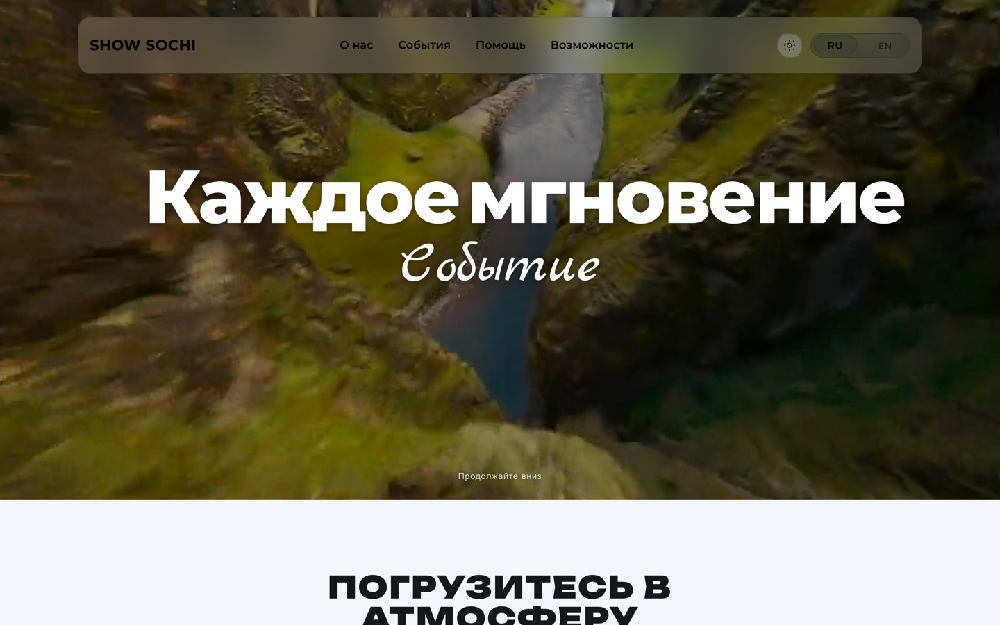

# ШоуСочи · амфитеатр в Сочи

Публичный сайт площадки: пенное шоу, кино под звёздами, кулинарные мастер-классы. Бронирование билетов уходит в WhatsApp, контент (расписание, обложки, доп-продукты) редактируется из админки в PostgreSQL.

**Демо:** <https://show-sochi.vercel.app>
**Прод клиента:** `шоусочи.рф` (IP сервера в репозитории не публикуется)



---

## Стек

| Слой | Что используется |
|---|---|
| Фреймворк | Next.js 15.4.11, App Router, React 19.1 |
| Стили | Tailwind CSS 4, CSS-модули нет, инлайн-токены темы |
| Данные | Prisma 5 + PostgreSQL, модели `User`, `Booking`, `Setting` |
| Авторизация | NextAuth 4 (credentials), пароли Argon2id |
| Шрифты | `next/font/google`: Geist, JetBrains Mono, Unbounded |
| Инфраструктура | PM2 + nginx, `deploy/` и `DEPLOY_SERVER.md` |

## Страницы

| Маршрут | Назначение |
|---|---|
| `/` | Видео-первый экран, события, программа, FAQ |
| `/about` | О площадке, блок доп-продуктов |
| `/shows/yupi`, `/shows/cinema`, `/shows/master` | Лендинги трёх форматов |
| `/booking`, `/booking/checkout` | Форма брони и подтверждение |
| `/legal/privacy`, `/legal/terms` | Правовые страницы |
| `/admin`, `/admin/bookings`, `/admin/site` | Заявки и редактор контента |
| `/api/booking/create`, `/api/admin/*` | Запись заявок, настройки, загрузка файлов |

## Как устроен контент

Единственный источник редактируемых текстов и картинок — таблица `Setting` (ключ/значение JSON), которая читается через `lib/settings.ts`. `getSettingsMap()` перехватывает любую ошибку БД и возвращает `{}`, а каждый вызывающий код передаёт дефолт, поэтому сайт отдаёт захардкоженный контент и без базы. Запись (бронь, логин, сохранение настроек) без базы не работает — это ожидаемое ограничение демо.

Язык хранится в cookie `lang`, тема — в cookie `theme`. Обе читаются на сервере, поэтому `<html lang>` и тёмная тема приходят уже в первом HTML, без мигания.

## Запуск

```bash
cp .env.example .env      # пусто = демо в режиме чтения
npm install               # postinstall сам запускает prisma generate
npm run dev
```

Для записи заявок нужны `DATABASE_URL` и `npx prisma migrate deploy`. Первый администратор создаётся скриптом `npm run db:seed` из `ADMIN_EMAIL` / `ADMIN_PASSWORD` — значения берутся только из окружения.

## Что в репозитории специально не лежит

`public/uploads/*` и `public/video/*` в `.gitignore`: туда пишет админка на проде. В демо исключены два файла — `drone.mp4` (2.1 МБ, вместо исходных 32 МБ) и `drone-poster.jpg`, чтобы первый экран и обложка брони не были пустыми.

## Что проверено на демо

10 маршрутов, HTTP 200, ноль ошибок в консоли, ноль битых картинок, видео в первом экране играет (`readyState 4`). `/admin` без сессии отдаёт 307 на `/admin/login`. Сборка без `DATABASE_URL` и без переменных окружения.

## Известные ограничения

- **Next.js зафиксирован на 15.4.11.** В 15.5.27 `next/font` падает на загрузке Google-шрифтов (`loader.js:122`, регулярка расширения не матчится), поэтому обновление — отдельная задача.
- **Нет `<h1>`** на `/about`, `/booking` и на трёх страницах `/shows/*`: главные заголовки рендерит `HeroLavaLetters` с жёстко заданным `Tag: "h2"`.
- **`MediaPlaceholder` не получает `lang`** в `PhotoMarquee.tsx:292` и `AboutShowSection.tsx:72`, поэтому в английской версии плейсхолдер галереи остаётся «Нет фото».
- Правовые страницы — черновик, текст ждёт юридических данных клиента.
- GA4 и Яндекс.Метрика выключены: ID читаются из `NEXT_PUBLIC_GA_ID` и `NEXT_PUBLIC_YANDEX_METRIKA_ID`, в демо не заданы.
